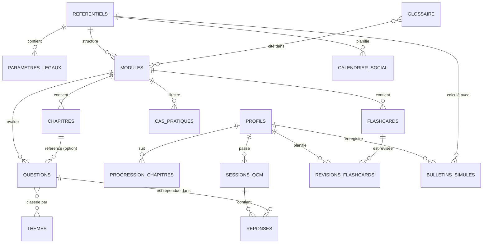

# Livrable 2 — Schéma de base de données

**SGBD :** PostgreSQL (Supabase). Authentification gérée par `auth.users` (Supabase Auth).
**Script SQL complet :** [supabase/migrations/0001_schema_initial.sql](../supabase/migrations/0001_schema_initial.sql)

---

## 1. Vue d'ensemble (diagramme entité-relation)

---

## 2. Description des tables

### 2.1 Référentiel et paramètres légaux (versionnés par année)

| Table | Rôle | Colonnes clés |
|---|---|---|
| `referentiels` | Une ligne par année (2026, 2027…) | `annee` (PK), `libelle`, `statut` (`brouillon` / `actif` / `archive`), `date_publication` |
| `parametres_legaux` | Copie en base du JSON de l'année (pour affichage, comparaison, historique) | `annee` (FK), `cle` (ex. `pmss.mensuel`), `valeur` (jsonb), `unite`, `statut_verification` (`publie` / `a_verifier`), `source_url`, `reference_juridique`, `date_effet`, `verifie_par`, `verifie_le` |

> **Source de vérité :** le fichier `parametres/2026.json` dans Git. La table est alimentée par script d'import. On évite ainsi deux versions divergentes.

### 2.2 Contenu pédagogique

| Table | Rôle | Colonnes clés |
|---|---|---|
| `modules` | Les 10 modules | `id`, `annee`, `numero` (1-10), `slug`, `titre`, `objectifs` (jsonb), `duree_estimee_min` |
| `chapitres` | Chapitres de cours, résumé, fiche, formules | `id`, `module_id`, `ordre`, `slug`, `type` (`cours` / `resume` / `formules` / `fiche` / `cas_pratique`), `titre`, `contenu_mdx`, `recherche` (tsvector, français) |
| `themes` | Thématiques transverses (« CSG », « absences »…) | `id`, `slug`, `libelle` |
| `questions` | Banque de QCM (format imposé) | `id` (ex. `M1-Q07`), `module_id`, `chapitre_id`, `niveau`, `type`, `enonce`, `choix` (jsonb), `bonne_reponse` (jsonb), `explication`, `reference`, `piege`, `annees_valides` (int[]), `actif` |
| `questions_themes` | Liaison N-N questions ↔ thèmes | `question_id`, `theme_id` |
| `flashcards` | Cartes recto/verso | `id`, `module_id`, `recto`, `verso`, `reference` |
| `cas_pratiques` | Dossiers corrigés pas à pas | `id`, `module_id`, `titre`, `enonce_mdx`, `etapes` (jsonb : question + correction par étape), `saisie_bulletin` (jsonb, rejouable dans le simulateur) |
| `glossaire` | Termes et sigles | `terme`, `sigle`, `definition`, `reference`, `modules_lies` (int[]) |
| `calendrier_social` | Échéances | `annee`, `date_echeance`, `libelle`, `categorie` (`DSN` / `URSSAF` / `annuel`), `condition` (ex. « effectif ≥ 50 »), `source_url` |

### 2.3 Apprenants et suivi

| Table | Rôle | Colonnes clés |
|---|---|---|
| `profils` | Prolonge `auth.users` | `id` (= `auth.users.id`), `prenom`, `statut_apprenant` (`etudiant` / `alternant` / `reconversion` / `professionnel`), `date_examen_visee`, `role` (`apprenant` / `formateur` / `admin`), `temps_majore` (bool, RGAA), `consentement_stats` |
| `progression_chapitres` | Chapitres lus / terminés | `profil_id`, `chapitre_id`, `statut` (`commence` / `termine`), `derniere_visite` |
| `sessions_qcm` | Une tentative (entraînement ou examen blanc) | `id`, `profil_id`, `mode` (`entrainement` / `examen_blanc`), `module_id` (null si examen), `duree_limite_s`, `debut`, `fin`, `score`, `nb_questions` |
| `reponses` | Réponse à une question dans une session | `session_id`, `question_id`, `reponse_donnee` (jsonb), `est_correcte`, `temps_s` |
| `revisions_flashcards` | Répétition espacée (algorithme SM-2) | `profil_id`, `flashcard_id`, `facteur_facilite`, `intervalle_jours`, `repetitions`, `prochaine_revision` |
| `bulletins_simules` | Bulletins enregistrés par l'apprenant | `id`, `profil_id`, `annee`, `saisie` (jsonb), `resultat` (jsonb), `cree_le` |

### 2.4 Vue calculée « points faibles »

`vue_points_faibles` : taux de réussite par apprenant × thème, sur les 30 derniers jours. Un thème est « point faible » si le taux est < 60 % sur au moins 5 questions. Le tableau de bord lit cette vue.

---

## 3. Sécurité (Row Level Security)

| Table | Lecture | Écriture |
|---|---|---|
| Contenu (`modules`, `chapitres`, `questions`, `glossaire`…) | Tout utilisateur connecté (et public pour le site de cours) | Rôle `formateur` ou `admin` |
| `questions.bonne_reponse` | **Jamais exposée avant la réponse** : lecture via une fonction `corriger_reponse()` côté serveur | — |
| Données apprenant (`profils`, `sessions_qcm`, `reponses`, `revisions_flashcards`, `bulletins_simules`) | Le propriétaire uniquement (`profil_id = auth.uid()`) ; formateur en lecture agrégée | Le propriétaire uniquement |

**RGPD :** données minimales (pas de NIR, pas de date de naissance). Droit à l'effacement : suppression en cascade depuis `auth.users`. Les bulletins simulés ne contiennent que des données fictives saisies par l'apprenant (avertissement affiché dans le simulateur).

---

## 4. Passage à 2027

1. Insérer `referentiels(2027, statut='brouillon')`.
2. Importer `parametres/2027.json`.
3. Script `marquer-questions-a-revoir` : toute question dont l'explication cite une clé de paramètre modifiée entre 2026 et 2027 reçoit `actif = false` jusqu'à relecture.
4. Basculer `statut='actif'` sur 2027 et `'archive'` sur 2026. Les bulletins simulés 2026 restent consultables avec leurs paramètres d'origine.
